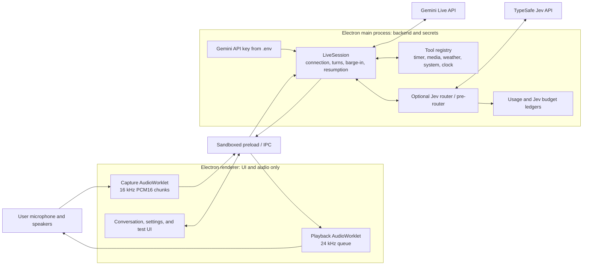

# Atlas Live

Atlas Live is a Turkish-first, speech-to-speech desktop assistant built with Electron and the Gemini Live API.

## What it is

- Native audio-in/audio-out interaction with Gemini Live, without a separate speech-to-text and text-to-speech cascade.
- Tool calling for timers, media control, weather, system status, and the current time.
- Turkish-first prompting, while switching language when the user does.
- Barge-in support that stops queued model audio as soon as the user starts speaking.
- Cost controls through bounded context, measured usage, local ledgers, and an optional budget-limited Jev router.

The default path lets Gemini select tools directly. Two experimental modes evaluate Jev (TypeSafe) as either a two-step selector or a pre-router that supplies a short tool hint.

## Architecture



The renderer is sandboxed with context isolation and no Node.js integration. It receives a narrow IPC surface from the preload script; the API key and network session remain in the main process. `LiveSession` is independent of Electron, so the probe and evaluation scripts can drive it headlessly.

Microphone capture is resampled to 16 kHz mono PCM16 in 50 ms chunks. Model audio is queued at 24 kHz and cleared on interruption. Session-resumption handles are used during planned server reconnects.

## Evaluation & measurements

The tool-selection evaluation used 34 Turkish cases, including 8 traps where no tool should run. Each case used a fresh session and state-changing tools ran dry.

| Measurement | Direct mode | Two-step Jev mode |
| --- | ---: | ---: |
| End-to-end accuracy | **33/34 (97%)** | 31/34 (91%) |
| Trap accuracy | **100%** | **100%** |
| Jev selector accuracy when called | Not applicable | **24/24 (100%)** |
| Standalone Jev selector | Not applicable | **68/68**, stable after option shuffling |
| First-audio latency, median / p95 | **1.72 s / 2.44 s** | 2.55 s / 5.07 s |
| First audio on tool turns, median | **1.77 s** | 2.84 s |
| Gemini text tokens per case | **1,419** | 1,722 (+21%) |
| Gemini cost for 34 cases | **$0.146** | $0.185 (+27%) |
| Jev overhead | None | 385 ms median; $0.0007 for 24 calls |

Jev itself was correct whenever Gemini called it. The failures came from the extra Live round trip: Gemini sometimes did not call the selector or did not execute the returned schema. The hypothesis that a pre-router would shrink context and reduce cost was **disproved** by measurement for this four-tool catalog. Direct mode therefore remains the default; the Jev modes remain experiments for larger catalogs.

A later voice pre-routing experiment found that a short hint worked in 8/8 trials. Asking Jev speculatively from a parallel live transcript reduced median first audio from 3.3 s to 2.5 s, though measured direct voice mode was still 2.2 s and pre-routing did not save tokens.

Billing experiments found that Live bills the full retained context on every turn, while silence is not billed. The default 8k context cap reduced the estimated hourly cost of continuous conversation by about 7x, from roughly ₺1,640 to ₺230 at the measured exchange rate.

## Safety & privacy by design

- The Gemini key is loaded by the main process and never exposed to renderer JavaScript.
- `.env` is for local secrets and is not committed; `.env.example` contains names only.
- Jev usage is written to a local ledger, and new paid Jev calls stop when the configured budget is exhausted.
- Context compression bounds retained conversation and limits the repeated-context billing exposure.
- The test panel has a dry-run mode in which timers and media controls describe changes without applying them.
- The desktop tool path does not yet provide per-action confirmation or an allow-list. Use it as trusted-user functionality; those controls are required before broader deployment.
- The Electron session grants renderer permission only for microphone audio.

## Run it

Requirements: a current Node.js/npm installation, a Gemini API key, and a desktop environment supported by Electron.

```bash
npm install
cp .env.example .env
# Add GEMINI_API_KEY to .env
npm start
```

Run the local unit tests:

```bash
npm test
```

Send a headless text question through the same `LiveSession` backend:

```bash
npm run probe -- "question"
```

Run the Turkish tool-selection evaluation (this makes billable API calls when credentials are configured):

```bash
node scripts/eval-tools.js
```

Jev modes additionally require `TYPESAFE_API_KEY`. Google Search is disabled by default because the measured free-tier Live configuration closed with a quota error; enable it only after configuring billing and understanding the cost.

## Status and limitations

Atlas Live is a personal project and an active experiment, not a production assistant. Prompts, evaluation cases, and most of the interface are currently Turkish. Tool support targets a Linux desktop and depends on host utilities for media, notifications, audio, and hardware readings.

The direct selector is the supported default. Jev and Jev pre-routing are retained for measurement, and the latter adds a paid parallel transcription stream. Long-idle automatic session shutdown is not implemented. Google Search needs at least a 16k context threshold in the tested configuration, so it weakens the default 8k cost ceiling.

## Related project

The native iPhone counterpart is [Atlas for iPhone](https://github.com/f23783/atlas-ios). This repository is [Atlas Live](https://github.com/f23783/atlas-live).

## License

MIT © 2026 Arda Fidancı. See [LICENSE](LICENSE).
